# Rust rewrite — why, what, and how it compares

niri is written in Rust, so I rewrote the parts of these dots that run all the time in Rust too. It makes the
setup more authentic, and it turned out to be cheaper as well. Everything that sits in the background
or answers every keystroke of an app was ported; the UIs stay QML.

Every port is a drop-in replacement: same input, same output, byte for byte where that is checkable.
The old implementations are kept as the fallback (and as the reference the tests compare against), so
nothing breaks on a machine without `cargo`.

## What was rewritten

| Part | Was | Now | Fallback |
|---|---|---|---|
| Glass Music backend | Python (`glassmusic.server`) | `apps/glass-music/backend` | `GLASS_MUSIC_PYTHON=python3`, or no binary |
| Glass Mail backend, IDLE watcher, `check` | Python | `apps/glass-mail/backend` | the Python package, same protocol |
| JP Quiz engine | Python | `apps/jp-quiz/engine` | the Python engine |
| `serp-sysdata` (sysmon samples) | `watchers/sys_fetcher.sh`, one run every 5 s | `rust/` | the bash script |
| `serp-niri-state` (bar + dock workspaces) | `niri msg --json event-stream`, parsed in QML | `rust/` | `niri msg` |
| `serp-focus` (focused window title) | `scripts/current_focus.sh` | `rust/` | the script |
| `serp-wellbeing` (Digital Wellbeing) | `guide/wellbeing/focus_daemon.py` | `rust/` | the Python daemon |
| `serp-kblocks` (Caps/Num Lock OSD) | Python inside `watchers/kb_locks.sh` | `rust/` | the script |
| `niri-autofit`, `niri-dwt-toggle`, `sleep-guard`, `power-mode` | Python / bash | `rust/` | `rust/reference/` |

## How it was tested

Differential testing: the old and new implementation get the same input in a sandbox, and everything
observable is compared (stdout, files and databases written, niri requests, D-Bus calls, commands run).

- **Glass Music:** a private MPD (own socket, database, null audio output) plus fakes for the Yandex worker, LRCLIB, `gio trash` and `music-smart`. 85 scripted UI sessions (search, queue, lyrics, covers, removal, downloads). Result: **0 differing steps**. Pure functions are fuzzed separately against CPython: casefold/lower tables, search normalisation and transliteration, the LRC parsers, embedded-lyrics readers, and cover colours and thumbnails pixel-for-pixel against Pillow's resampler (0 differences). The MPD retry logic has its own unit tests.
- **Glass Mail:** a throwaway Dovecot in Docker, never a real account. 256 live steps with 0 foreground differences. 2,448 generated drafts are byte-identical on the wire. The IDLE watcher is diffed too.
- **JP Quiz:** about 1,300 requests per run on a copy of a progress database and on a fresh one (two seeds): 0 mismatches, identical databases afterwards. The real progress database is never touched.
- **Helpers:** `rust/tests/run-all.sh` runs unit tests plus one differential test per helper, against a fake niri socket, private D-Bus buses and a private `/tmp`. Run it with `--live` to also compare `serp-niri-state` with the running niri (read-only).

## Numbers

Measured on the same laptop (Lunar Lake). "CPU" is user + system time over the same scripted session.

### Apps

| App | Measure | Python | Rust |
|---|---|---|---|
| Glass Music | CPU over the 85-step session | 0.72 s | 0.38 s |
| Glass Music | peak memory | 56 MB | 41 MB |
| Glass Music | 3,000 search queries (index + JSON I/O) | 26.0 s | 7.25 s |
| Glass Mail | CPU over the 256-step session | 1.81 s | 0.76 s |
| Glass Mail | session memory | 43 MB | 33 MB |
| Glass Mail | IDLE watcher memory | 35 MB | 21 MB |
| Glass Mail | `check` run | 0.26 s | 0.13 s |
| Glass Mail | parse + login-code scan over a large mailbox | 14.5 s | 2.4 s |
| JP Quiz | CPU over a 1,300-request session | 4.3–4.7 s | 1.6 s |
| JP Quiz | memory | 72 MB | 36 MB |

Wall time of the scripted sessions is the same for both: they are paced by the UI script, not by the backend.
Lyrics loading is disk-bound and equal (0.12 s vs 0.14 s).

### Background helpers

| Helper | Before | After (resident memory, live) |
|---|---|---|
| `serp-sysdata` | about 51 processes and 48 ms CPU per sample (every 5 s) | one process, 0.44 ms per sample, 2.5 MB |
| `serp-wellbeing` | 20.3 MB (Python) | 6.3 MB |
| `serp-kblocks` | woke on every key press and release | the kernel masks everything but LED events (`EVIOCSMASK`); 2.4 MB |
| `serp-niri-state` | `niri msg` + JSON parsing in the shell | prints only the compact state the bar needs; 2.5 MB |
| `serp-focus` | shell script | 2.6 MB |
| `niri-autofit` | 13.9 MB (Python) | 2.6 MB |
| `niri-dwt-toggle` | 17.2 MB (Python) | 3.5 MB |
| `sleep-guard` | 31 MB (Python) | 3.1 MB |
| `power-mode` | 2–4 MB (bash) | 3.5 MB (about the same; it no longer forks per check) |

```mermaid
xychart-beta
    title "Resident memory, MB (Python/bash vs Rust)"
    x-axis ["wellbeing", "autofit", "dwt-toggle", "sleep-guard", "Music", "Mail", "JP Quiz"]
    y-axis "MB" 0 --> 80
    bar [20.3, 13.9, 17.2, 31, 56, 43, 72]
    bar [6.3, 2.6, 3.5, 3.1, 41, 33, 36]
```

## Where the differences come from

- **No interpreter.** A Python process starts at 10–20 MB before it does anything, and every bash
  poll forks `grep`, `awk`, `date` and friends. The Rust helpers are single small processes that sleep
  in `poll()` until niri, the kernel or a timer wakes them.
- **Event-driven instead of polling where the old code polled.** For example, `serp-kblocks` lets the kernel filter
  input events, and `serp-sysdata` keeps `/proc` files open and re-reads them instead of spawning a
  pipeline every sample.
- **Same behaviour, quirks included.** The ports reproduce Python's exact semantics wherever output
  depends on them: `str.casefold`/`lower` tables generated from CPython, `round` half-to-even,
  `json.dumps` separators, stable sorts, `Counter.most_common` tie order, Pillow's fixed-point
  bicubic/Lanczos resampler. That is what makes byte-for-byte comparison possible.

## Building

`install/glass.sh` builds `rust/` and installs the helpers. Each app's `install.sh` builds its own
backend. Without `cargo`, everything falls back to the original scripts automatically.
